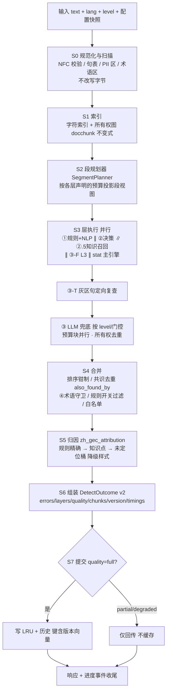

# 检测处理流程设计（Detect Pipeline v2）

> 状态：**P1–P3 已实现**（2026-11-19，本文同时是实现契约，§2 流程图与代码同步）；
> P4 全部落地：**段级进度事件** ✅（chunk_begin/chunk_end，见 §7）；**入口收敛** ✅（api-server 内 `run_pipeline` 唯一执行入口，detect×2 / analyze 降为驱动，见 §8）；**桌面并轨** ✅（桌面端 `commands.rs` 新增同构 `run_pipeline`，detect / analyze 降为驱动；残余差异：桌面仍为独立实现但语义同构，进程级 LRU 缓存桌面缺失；zh 归因改按粗族折叠对齐 api，见 §8）；**可观测性四件套** ✅（dropped 账本 / 每请求 summary / 两告警 / 看板，见 §7）。
> 动因：2026-11 缓存/切块排查（旧结果命中、忽略缓存同结果、CSC 臂静默截断、归因兜底桶误导排查）暴露的设计成因见 `docs/UX_REVIEW.md` 后续与 EVOLUTION 记录；本文的设计与 §8 分期进度即现状。

## 1. 设计原则（不可协商项）

1. **单一组装**：一条流水线由一个可序列化的 `PipelineSpec` 描述；所有入口（编辑器 Web / 桌面 / 文档审校作业 / analyze / media / MCP）只是它的**驱动**，不得各自实现策略。
2. **span 契约贯穿**：错误一律携带原文**字节偏移** span；任何文本变换（PII 掩码、上下文前缀）必须等长或不改原文；切块与重映射**只有一处实现**（段规划器，§3）。
3. **永不静默丢弃**：输入超出某层预算 → 必须分块；不可分块则显式报错。被丢弃的检出一律计数并归因到丢弃原因。
4. **质量自描述**：结果自带 `quality`（coverage / 降级 / 丢弃账本）；降级不得伪装成正常结果，「未定位到具体规则」的归因不得冒充正常归因卡。
5. **版本锚定**：结果与缓存都携带**版本向量**；规则/决策表/模型/prompt 任一变更自动使全部旧缓存键漂移，`refresh` 与 `cache/clear` 仅为兜底手段。

## 2. 总览



## 3. 段规划器（SegmentPlanner）——切块唯一所在

**位置**：流水线编排层（api-server / 共享 crate 内），不在任何层客户端内部，也不在外围服务（csc_server / LLM 端点保持**切块盲**，只接收预算内文本）。

**模型**：一次索引，多次投影。`docchunk::split_document` 的所有权不变式（每字符恰好归属一块）提升为全局原语；各层声明预算，规划器从同一字符索引切出该层段视图：

| 层 | 粒度 | 预算来源 |
|---|---|---|
| ① 规则 / NLP | 全文单段 | 无 |
| ② 决策模型 / ③-F L3 / ②.5 知识召回 | 句级 | 特征/向量模型窗口 |
| ③ LLM 兜底 | 预算块（默认 target 1500，含只读上下文前缀） | prompt 预算 + `llm_chunk_target_chars` 设置 |
| stat/CSC | token 预算窗（MacBERT 512） | `stat_window_tokens` 设置 |

**规则**：
- 重叠/上下文前缀只读；**归属权决定去重**（跨段重复检出按所有权丢弃，一处实现，泛化现 `llm::remap_chunk_errors`）；
- 预算超限必须分块，规划器是唯一的截断裁判；「静默截断」视为契约违例，测试红；
- stat 臂修复即在此落地：Rust 侧按 512-token 窗滑切、逐窗调用、字节 span 重映射（`csc_server` 的响应契约已是字节 span，零 Python 改动或仅去掉截断路径）。

**设置化**：切块预算进运行时设置面板（现散在 `GEC_LLM_CHUNK_CHARS` / `GEC_LLM_CHUNK_TARGET` / 服务内常量），并回显在结果元数据（§5 `chunks.mode`）。

### 3.1 两种分块：句级分块与段级分块（预算块）

一次运行的物理切块次数：**句级恒 1 次**（S1 建句表全局共享）+ **段级每预算层 1 次投影**（当前仅 ③ LLM 与 stat/CSC，预算相同则共享）。

| 维度 | 句级分块（结构切分） | 段级分块（传输切分） |
|---|---|---|
| 来源 | 文本句边界（切句器：HanLP / 标点兜底） | 模型/prompt 预算经 planner 投影 |
| 次数 | 恒 1，全局共享 | 每预算层 1 份 |
| 确定性 | 只随切句器版本变 | 随 target / overlap / 预算变 |
| 所有权与重叠 | 天然铺满，无需前缀 | 只读上下文 + 所有权去重 |
| 消费方 | ②决策、②.5 召回、③-F L3、③-T 定向复查、triage | ③ LLM 分块、stat 窗 |
| 缓存指纹 | 句 hash + 层 fp + splitter 版本 | 段 hash + 层 fp + planner 参数 |
| 覆盖维度 | 句未复查率 | coverage + `unowned_chars` |

推论：③-T 定向复查是**句级**事件（成本≈灰区句长），计入句覆盖不计入 chunks；版本向量增 `splitter` 字段（HanLP ↔ 标点兜底切换必须让句级层缓存漂移）；结果同时携带 `sentences` 与 `chunks` 两个维度，各算各的账。

## 4. 层执行与失败语义

| 事件 | 记账 | 对结果的影响 |
|---|---|---|
| 块网络失败（重试 1 次后） | `failed_chunks++` | coverage 下降，`quality=partial` |
| 块解析失败 | `parse_failed_chunks++` | 该块**未复查**，禁止折算为空结果（现 `take_parse_failed` 语义保留） |
| 层服务不可用 | `layers[层]=unavailable` | 辅助层：降级继续；规则核心层：502 |
| LLM 触发但未配置 | — | 503（现状保留） |
| 归因决策表 miss | `attribution.fallback++` | 错误带「未定位到具体规则」降级卡（非正常卡） |
| 检出落在 PII 掩码区 / 越界 / 非所有权段 | `dropped{reason}++` | 丢弃账本回传，聚合可见 |

缓存资格规则：**仅 `quality=full` 的运行可写 LRU / 历史**。partial/degraded 结果只回传不缓存——杜绝「降级结果被缓存放大」这类事故。

## 5. DetectOutcome v2（回传契约）

```jsonc
{
  "errors": [ /* 含 source / rule_id / span / confidence / attribution */ ],
  "layers": [ { "layer": "rule|stat|decision|recall|l3|llm", "status": "ran|partial|unavailable", "found": 0 } ],
  "quality": {
    "status": "full | partial | degraded",
    "coverage": 1.0,            // 已复查块 / 总块；全文路径恒 1.0
    "unowned_chars": 0,         // 所有权图空洞，必须恒 0（截断探测器）
    "dropped": { "ownership": 0, "pii_mask": 0, "out_of_range": 0, "out_of_scope": 0 },
    "degraded_reasons": []      // 如 "nlp_unavailable", "stat_unavailable"
  },
  "chunks": { "mode": "single|chunked", "total": 2, "done": 2, "failed": 0, "cache_hit": 1 },
  "sentences": { "total": 43, "reviewed": 43 },
  "version": { "rules_fp": "…", "tables": "…", "model": "…", "prompt": "…", "splitter": "hanlp|punct", "spec": "…" },
  "timings": { /* 现状保留 */ },
  "from_history": false, "from_cache": false
}
```

前端一等公民展示：`quality.status ≠ full` 徽标 + 悬浮原因；归因兜底桶渲染为「未定位到具体规则」的告警样式，文案不得呈现常规补救卡。

**已实现契约（P1 落地版，与代码一致）**：
- `quality` = `{status, coverage?, unowned_chars, degraded_reasons[], dropped?}`；`dropped` = 四桶丢弃账本（§7 已落地：ownership / pii_mask / out_of_range / out_of_scope，空则省略）；LRU / 历史回放不携 `quality`；
- `chunks` = `{mode, total, done, failed, parse_failed}`（无 `cache_hit`）；
- `sentences` = `{total, reviewed}`；
- `version` 实际成分 = `{rules_fingerprint, model_version?, splitter}`（决策表 / prompt 漂移已分别被规则指纹哈希与模型版本号覆盖，不单列；`spec` 未入键）；仅实检返回；
- 不返回 `from_cache`：LRU 命中以 `quality`/`version` 缺失识别（回放恒不携），历史复用仍用 `from_history`；
- 徽标与兜底桶样式已落地：ResultsPanel 降级徽标（悬浮原因 + 覆盖率 +「不写缓存」提示）、Attribution 的 `grammar_novice` 告警态（隐补救/教材卡）。

## 6. 缓存与失效

**三级缓存，一套指纹**：
1. **段级**内容寻址缓存（key = 段内容 hash + 层指纹；`docjob.chunk_cache` 现成）——跨文档增量复用；
2. **文档级 LRU**（key = 文本 hash + 版本向量；现 `cache.rs` 设计推广）；
3. **历史层** SQLite（复用需版本向量逐项一致；现门槛保留）。

**变更即失效（版本总线）**：规则 toggle → `rules_fp` 重算；决策表热更 / 回滚 → `tables` 版本；模型热切换 → `model`；prompt 编辑 → `prompt`。版本向量递增使所有键自然漂移，无需显式清。`POST /gec/cache/clear` 与 `refresh: true` 保留为手动手段（运维手册已载）。

## 7. 可观测性与告警

- 进度事件（`X-Progress-Id` 现通道）扩到**段级**：`chunk:begin / chunk:end`——**已实现**（`StageEvent::ChunkBegin/ChunkEnd`，wire kind `chunk_begin`/`chunk_end`；③ LLM 整文档分块与 stat 滑窗两条预算路径；短文本单块不推）；
- 每请求一行结构化 summary（含版本向量 + quality + chunks + dropped）——**已实现**（api-server `request_summary` SQLite 账本：detect / analyze 每次实检在 `run_pipeline` 内无条件落行，回放行 quality 置 NULL；按天 × 版本聚合见 summary 端点。**残余**：doc-jobs / media / 桌面不写行）；
- **两个必设告警**——**已实现**（`GET /gec/observability/alerts`，24h 窗口）：
  1. `unowned_chars ≠ 0` 或发生任何静默截断（dropped 四桶非零）→ 完整性回归（本类事故的探测器；写行处同时 `tracing::error!` 即时点名）；
  2. 归因兜底桶命中率突增（grammar_novice 兜底率 >30% 且样本 ≥20）/ `quality=partial 且 errors=空` 危险象限成模式（≥5 次）→ 质量回归。
- 其余面板——**已实现**（`GET /gec/observability/summary?days=N`：day × 规则指纹聚合——coverage 均值、句未复查率（reviewed 侧）、层 unavailable 率、cache 命中率、history 复用率、dropped 分原因、LLM 调用代理（段级完成块数）、总耗时 P95；web-ui 进化中心「可观测」标签页。**残余**：每块 P95 需块级耗时列，二期）。

## 8. 入口（驱动）与迁移路线

**入口统一**：`api-server` 内一条 `run_pipeline(spec, request)`；Web = HTTP 驱动；doc-jobs = 批量驱动（复用 S1/S2 + job 持久化断点续跑）；analyze = detect+归因组合驱动；桌面 = 并轨到同一函数（内嵌 api-server 或共享 crate），`commands.rs` 只做参数透传——**消除第二实现**。

**分期**：
1. **P1（小）** ✅：Outcome v2 的 `quality/chunks/sentences/version` 字段（向后兼容可选字段）+ 前端降级徽标 + 归因兜底桶改样式；金集评测（media_gold_eval）在 CI。
2. **P2（中）** ✅：切块统一到所有权不变式原语（docchunk）；stat/CSC 滑窗修复 + 字节 span 重映射钳制；引擎合并测试按钳制语义重写。
3. **P3（中）** ✅：版本向量含 `splitter`（缓存键 `:s…` 段）+ 缓存资格规则（仅 full 可写 LRU/历史，detect/analyze/桌面三门同构）；切块预算进设置面板——**未做**，遗余。
4. **P4（大）** ✅（「桌面并轨」子项于收尾落地）：**段级进度事件** ✅（chunk_begin/chunk_end，LLM 分块 + stat 滑窗两条预算路径）；**入口收敛** ✅（api-server 内 `run_pipeline` 唯一执行入口：detect×2 的重复 persist 块与 analyze 的内联执行实现全部消除，analyze 降为 detect+归因组合驱动并从此获得 LRU / anomaly 采纳 / L3 后台任务；mcp / media 直驱 `run_detection`）；**桌面并轨** ✅（桌面 `commands.rs` 新增 `run_pipeline`（历史复用 / 级联 / 抑制过滤 / issue_type / anomaly 采纳 / L3 采集 / 参数快照单一实现），detect / analyze 降为驱动；历史表补齐 corrected_text / layers_json 两列（轻量迁移）并支持 layers 回放；analyze 归因 zh 按粗族折叠对齐 api（§11.11 兼容）。残余差异：桌面仍为独立实现（非共享 crate）但语义同构；进程级 LRU 缓存桌面本就无，未补）；**可观测性四件套** ✅（dropped 账本 / 每请求 summary / 两告警端点 / 看板与进化中心「可观测」页，见 §7）。

**验收**（每期）：现有 api-server/gec-core 全套 + 新增契约测试（所有权铺满全文、预算不超限、span 重映射往返、版本漂移）+ 黄金集 F1 不退化 + 两告警零命中。
